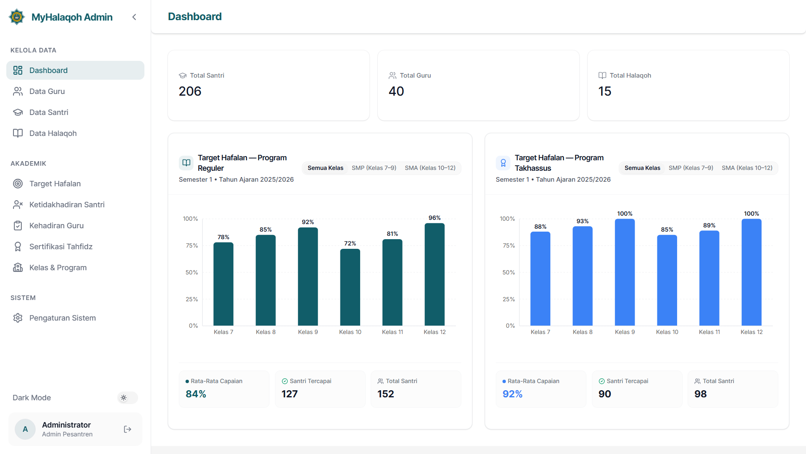
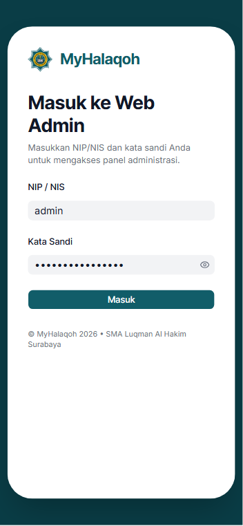
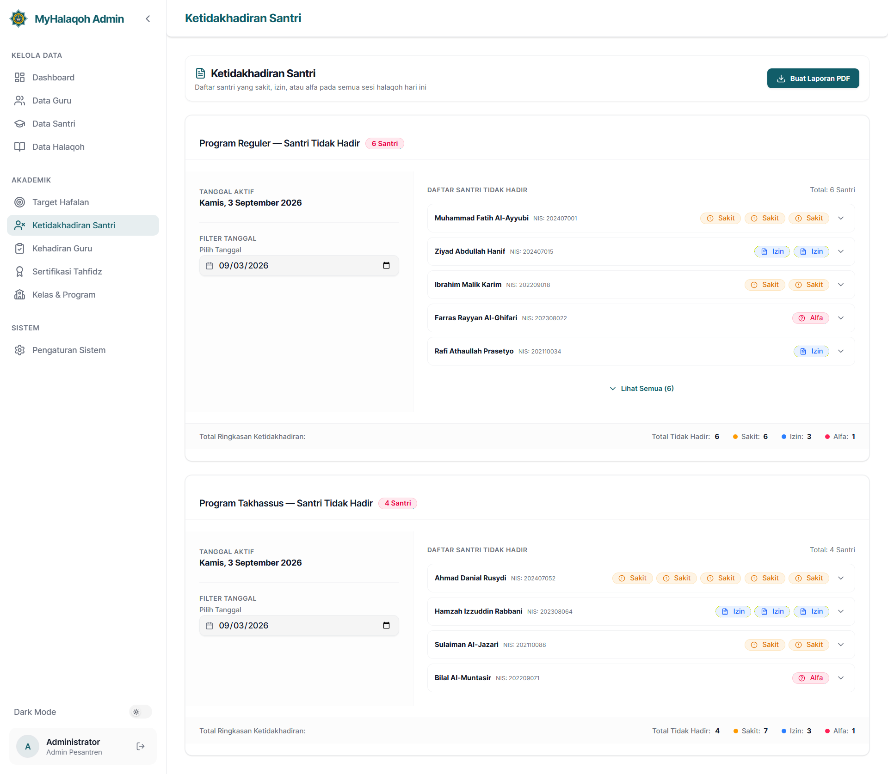

<div align="center">


# MyHalaqoh Admin Web

**Sistem Manajemen Pesantren Modern — Panel Administrasi Berbasis Web**


[Fitur](#fitur) · [Tech Stack](#tech-stack) · [Arsitektur](#arsitektur) · [Memulai](#memulai) · [Deployment](#deployment)

<br />



</div>

---

## Tentang Proyek

**MyHalaqoh Admin Web** adalah web-based administration panel yang dibangun sebagai pendamping aplikasi mobile [MyHalaqoh](https://myhalaqoh.com) — sebuah sistem manajemen pesantren (Islamic boarding school) terintegrasi untuk mengelola kegiatan tahfidz Al-Qur'an.

Panel admin ini digunakan oleh staf administrasi pesantren untuk mengelola seluruh data master — guru, santri, kelompok halaqoh, target hafalan, dan struktur akademik — yang kemudian dikonsumsi secara real-time oleh aplikasi mobile Flutter yang digunakan oleh guru pengampu dan wali santri.

> [!NOTE]
> Web admin ini **berbagi backend Firebase yang sama** dengan aplikasi mobile Flutter yang sudah berjalan di production. Tidak ada backend terpisah — keduanya membaca dan menulis ke Firestore, Auth, Storage, dan Cloud Functions yang identik.

### Konteks

Proyek ini dikembangkan sebagai bagian dari penelitian skripsi untuk membangun solusi digitalisasi manajemen pesantren yang menyeluruh. Sistem terdiri dari:

| Komponen | Teknologi | Pengguna |
| :--- | :--- | :--- |
| **Mobile App** | Flutter / Dart | Guru Pengampu, Wali Santri |
| **Admin Web** ← _repo ini_ | Next.js / TypeScript | Staff Administrasi Pesantren |
| **Backend** | Firebase (Firestore, Auth, Storage, Functions) | Shared |

---

## Fitur

### Data Master & Operasional

- **Manajemen Guru** — CRUD lengkap, bulk import CSV/Excel, reset password via Cloud Functions
- **Manajemen Santri** — CRUD, filter kelas/program/alumni, bulk import, wizard kenaikan kelas batch
- **Manajemen Halaqoh** — Card grid view, assign/transfer santri antar kelompok, batas maks 15 santri per halaqoh
- **Target Hafalan** — Kurikulum tahfidz per kelas/program (Reguler & Takhassus), konfigurasi tahun ajaran & semester
- **Sertifikasi Tahfidz** — Kelola pendaftaran & hasil ujian sertifikasi hafalan per juz
- **Kehadiran Santri & Guru** — Monitoring dan rekapitulasi absensi per sesi halaqoh

### Dashboard & Monitoring

- **Statistik Real-time** — Total santri, guru, dan halaqoh aktif
- **Capaian Target Hafalan** — Progress per kelas dengan visualisasi chart
- **Capaian Kehadiran** — Monitoring kehadiran santri per kelas

### Laporan & Ekspor

- **PDF Report Generation** — Laporan hafalan dan absensi per halaqoh, siap cetak
- **Bulk Export** — Template Excel/CSV untuk import data

### Sistem & UX

- **Multi-Language (i18n)** — Bahasa Indonesia 🇮🇩 & English 🇬🇧, switch instan tanpa reload
- **Dark Mode** — Light / Dark / System preference, persisted
- **Responsive Design** — Optimized untuk desktop dan tablet
- **Landing Page** — Halaman publik dengan informasi produk

<br />

<div align="center">

| Login | Dashboard | Kehadiran Santri |
| :---: | :---: | :---: |
|  |  |  |

</div>

---

## Tech Stack

| Layer | Teknologi |
| :--- | :--- |
| **Framework** | [Next.js 16](https://nextjs.org) (App Router, Turbopack) |
| **Language** | [TypeScript 5](https://www.typescriptlang.org) |
| **Styling** | [Tailwind CSS 4](https://tailwindcss.com) + CSS Variables Design System |
| **UI Components** | [shadcn/ui](https://ui.shadcn.com) (preset Rhea) + [Lucide Icons](https://lucide.dev) |
| **Backend** | [Firebase 12](https://firebase.google.com) — Firestore, Auth, Storage, Cloud Functions |
| **State Management** | [TanStack Query v5](https://tanstack.com/query) (server state) + [Zustand](https://zustand.docs.pmnd.rs) (UI state) |
| **Tables** | [TanStack Table v8](https://tanstack.com/table) |
| **Forms** | [React Hook Form](https://react-hook-form.com) + [Zod](https://zod.dev) |
| **PDF** | [@react-pdf/renderer](https://react-pdf.org) |
| **Charts** | [Recharts](https://recharts.org) |
| **i18n** | [react-i18next](https://react.i18next.com) |
| **Animation** | [Motion](https://motion.dev) (Framer Motion v12) |
| **Testing** | [Vitest](https://vitest.dev) + [React Testing Library](https://testing-library.com) |
| **CI/CD** | [GitHub Actions](https://github.com/features/actions) + [Firebase App Hosting](https://firebase.google.com/docs/app-hosting) |

---

## Arsitektur

### Feature-First Project Structure

```
halaqoh-admin-web/
├── public/                          # Static assets, logo, templates
├── src/
│   ├── app/                         # Next.js App Router (pages & layouts)
│   │   ├── (auth)/login/            #   Login page
│   │   ├── (dashboard)/             #   Protected admin area
│   │   │   ├── guru/                #     Manajemen Guru
│   │   │   ├── santri/              #     Manajemen Santri
│   │   │   ├── halaqoh/             #     Manajemen Halaqoh + Detail [id]
│   │   │   ├── target-hafalan/      #     Target Hafalan
│   │   │   ├── kehadiran-santri/    #     Kehadiran Santri
│   │   │   ├── kehadiran-guru/      #     Kehadiran Guru
│   │   │   ├── sertifikasi/         #     Sertifikasi Tahfidz
│   │   │   └── settings/            #     Pengaturan
│   │   └── (landing)/               #   Public landing page
│   │
│   ├── features/                    # Feature modules (feature-first)
│   │   ├── auth/                    #   actions, hooks, schemas, components
│   │   ├── guru/
│   │   ├── santri/
│   │   ├── halaqoh/
│   │   ├── target-hafalan/
│   │   ├── kehadiran-santri/
│   │   ├── kehadiran-guru/
│   │   ├── sertifikasi/
│   │   ├── kelas-program/
│   │   ├── dashboard/
│   │   ├── settings/
│   │   └── landing/
│   │
│   ├── components/                  # Shared UI components
│   │   ├── ui/                      #   shadcn/ui primitives
│   │   ├── layout/                  #   Sidebar, Header, Breadcrumb
│   │   ├── data-table/              #   Generic TanStack Table wrapper
│   │   ├── forms/                   #   Image upload, CSV upload, Confirm dialog
│   │   └── providers/               #   Query, Theme, Firebase, Auth providers
│   │
│   ├── lib/                         # Utilities & configuration
│   │   ├── firebase/                #   Firebase init (Auth, Firestore, Storage)
│   │   ├── firestore/               #   Typed queries, converters, collections
│   │   ├── i18n/                    #   i18n config + locale files (id, en)
│   │   └── utils/                   #   Date, CSV, program helpers
│   │
│   ├── hooks/                       # Global custom hooks
│   ├── stores/                      # Zustand stores (auth, UI state)
│   ├── types/                       # TypeScript type definitions
│   └── styles/                      # Global CSS + Design System tokens
│
├── .github/workflows/               # CI pipeline (ci.yml)
├── vitest.config.ts                  # Test configuration
├── apphosting.yaml                   # Firebase App Hosting config
└── package.json
```

### Data Flow

```
┌─────────────────┐      ┌──────────────────┐      ┌─────────────────┐
│   Admin Web     │◄────►│    Firebase      │◄────►│   Mobile App    │
│   (Next.js)     │      │  (Shared BaaS)   │      │   (Flutter)     │
│                 │      │                  │      │                 │
│  • Firestore    │      │  • Firestore DB  │      │  • Guru App     │
│  • Auth         │      │  • Auth          │      │  • Wali Santri  │
│  • Storage      │      │  • Storage       │      │                 │
│  • Functions    │      │  • Functions     │      │                 │
└─────────────────┘      └──────────────────┘      └─────────────────┘
```

> [!IMPORTANT]
> Model data Firestore **sudah ditetapkan dari aplikasi mobile** dan bersifat shared. Perubahan skema pada sisi web akan berdampak langsung pada aplikasi mobile yang sedang berjalan di production.

---

## Memulai

### Prasyarat

- [Node.js](https://nodejs.org) **v20** atau lebih baru
- [npm](https://www.npmjs.com) (bawaan Node.js)
- [Git](https://git-scm.com)
- Akses ke project [Firebase Console](https://console.firebase.google.com) (untuk konfigurasi environment)

### Instalasi

1. **Clone repository**

   ```bash
   git clone https://github.com/<your-username>/halaqoh-admin-web.git
   cd halaqoh-admin-web
   ```

2. **Install dependencies**

   ```bash
   npm install
   ```

3. **Konfigurasi environment**

   Salin file template dan isi dengan kredensial Firebase project:

   ```bash
   cp .env.example .env.local
   ```

   Isi `.env.local` dengan nilai dari Firebase Console → Project Settings → Your apps → Web app:

   ```env
   NEXT_PUBLIC_FIREBASE_API_KEY=<your-api-key>
   NEXT_PUBLIC_FIREBASE_AUTH_DOMAIN=<your-auth-domain>
   NEXT_PUBLIC_FIREBASE_PROJECT_ID=my-halaqoh
   NEXT_PUBLIC_FIREBASE_STORAGE_BUCKET=<your-storage-bucket>
   NEXT_PUBLIC_FIREBASE_MESSAGING_SENDER_ID=<your-sender-id>
   NEXT_PUBLIC_FIREBASE_APP_ID=<your-app-id>
   ```

4. **Jalankan development server**

   ```bash
   npm run dev
   ```

   Buka [http://localhost:3000](http://localhost:3000) di browser.

> [!TIP]
> Login memerlukan akun Firebase Auth dengan role `admin`. Akun admin dapat dibuat melalui Firebase Console atau melalui aplikasi mobile.

### Scripts

| Perintah | Deskripsi |
| :--- | :--- |
| `npm run dev` | Menjalankan development server (Turbopack) |
| `npm run build` | Build production |
| `npm start` | Menjalankan production build |
| `npm run lint` | Menjalankan ESLint |
| `npm test` | Menjalankan seluruh test suite (Vitest) |
| `npm run test:watch` | Menjalankan test dalam watch mode |
| `npm run typecheck` | Type checking (tsc --noEmit) |
| `npm run verify` | Menjalankan full verification gate (typecheck + lint + test + build) |

---

## Testing

Project ini menerapkan **automated testing** dengan Vitest + React Testing Library:

- **296 unit & component tests** dengan waktu eksekusi < 5 detik
- **CI Gate** otomatis pada setiap Pull Request via GitHub Actions
- Helper `renderWithProviders()` untuk menyediakan QueryClient & i18n context
- Mock Firebase services untuk isolasi test

```bash
# Jalankan semua test
npm test

# Watch mode untuk development
npm run test:watch
```

---

## Deployment

### Production (Firebase App Hosting)

Aplikasi di-deploy ke production secara otomatis melalui **Firebase App Hosting**:

1. Setiap PR ke `main` melewati CI Gate (typecheck → lint → test → build)
2. Setelah merge ke `main`, Firebase App Hosting otomatis build & deploy
3. Aplikasi live di **[myhalaqoh.com](https://myhalaqoh.com)**

### CI/CD Pipeline

```
Feature Branch → Pull Request → CI Gate (GitHub Actions) → Merge → Auto Deploy
                                    │
                                    ├── typecheck (tsc --noEmit)
                                    ├── lint (eslint --max-warnings=81)
                                    ├── test (vitest run — 296 tests)
                                    └── build (next build)
```

> [!CAUTION]
> Push langsung ke `main` tidak diperbolehkan. Seluruh perubahan wajib melalui Pull Request dengan CI Gate berstatus hijau.

### Rollback

Jika terjadi masalah kritis setelah deployment:

1. Buka Firebase Console → App Hosting → backend `my-halaqoh-admin-web` → Rollouts
2. Pilih rollout stabil sebelumnya → Roll back
3. Buat PR `revert` untuk perbaikan permanen

---

## Design System

Aplikasi menggunakan design system berbasis **CSS Variables** sebagai single source of truth, dengan token yang konsisten antara web dan mobile app.

| Aspek | Detail |
| :--- | :--- |
| **Brand Color** | Teal `#115D69` |
| **Font** | Inter (via `next/font/google`) |
| **Component Library** | shadcn/ui (preset Rhea) |
| **Dark Mode** | `next-themes` dengan class strategy |
| **Token Files** | `src/styles/theme.css` → `src/theme/*.ts` |

Komponen tidak menggunakan hardcoded color. Seluruh warna mengacu ke CSS variable melalui Tailwind utility class (`bg-primary`, `text-foreground`, `bg-success`, dll).

---

## Internasionalisasi (i18n)

Mendukung **2 bahasa** dengan switch instan tanpa reload halaman:

- 🇮🇩 Bahasa Indonesia (default)
- 🇬🇧 English

Implementasi menggunakan `react-i18next` dengan **10 namespace modular** (`common`, `nav`, `auth`, `dashboard`, `guru`, `santri`, `halaqoh`, `targetHafalan`, `kelasProgram`, `settings`). File terjemahan tersimpan di `src/lib/i18n/locales/{id,en}/`.

---
